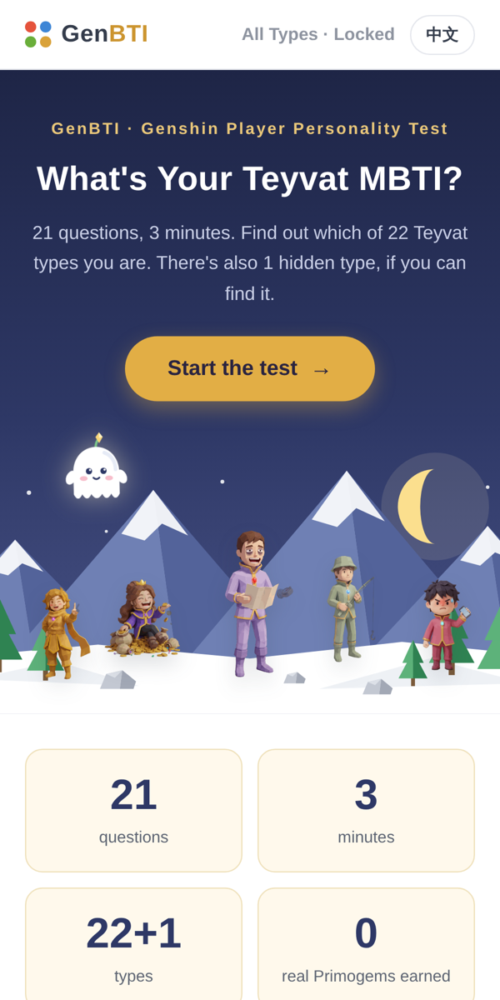
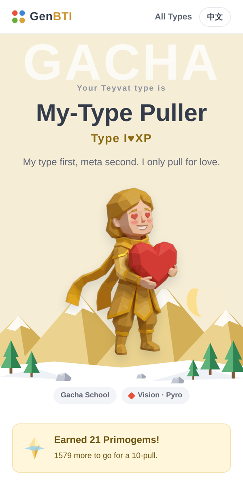
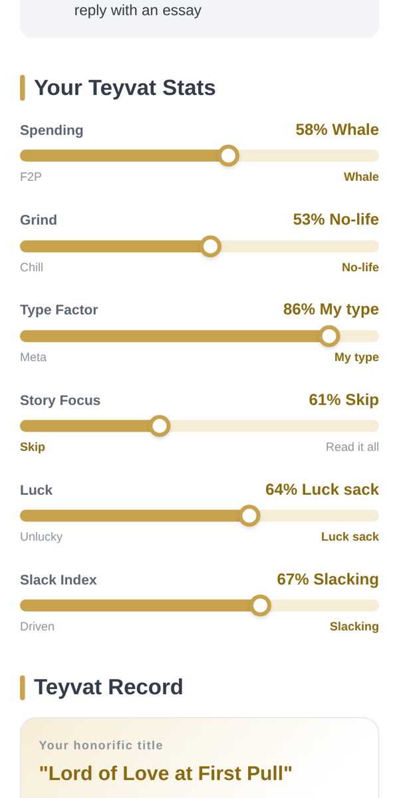
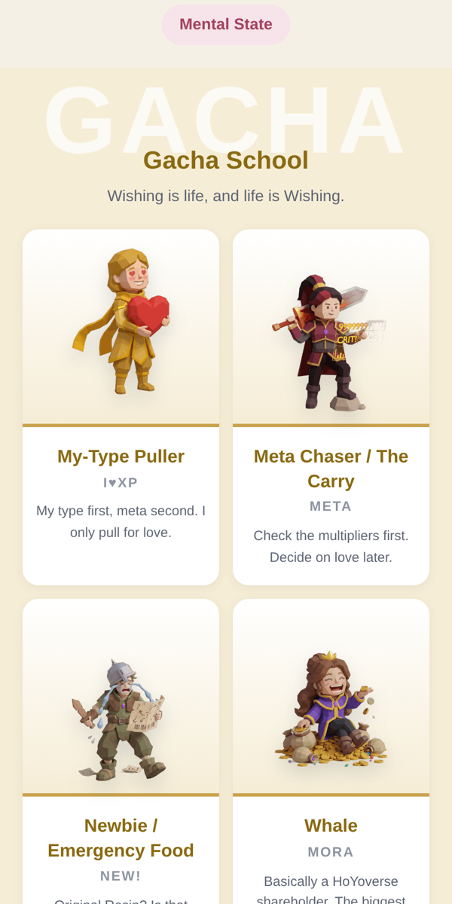

# GenBTI · 原BTI

**A bilingual (English / 中文) personality quiz for Genshin Impact players.**
Answer 21 questions and find out which of 22 Teyvat player types you are. There is also one hidden type.

**Live:** [yuanbti.pages.dev](https://yuanbti.pages.dev) · also published as a Xiaohongshu (小红书) mini-tool

<p>
  
  
  
  
</p>

## Features

- **22 types + 1 hidden type**, grouped into four schools: Gacha, Playstyle, Life and Mental State. Each type has a profile, three telltale signs, a title, a nickname from Paimon, a best partner and a nemesis.
- **Primogem progress bar**: every answer earns one Primogem.
- **Stat bars** for spending, grind, type factor, story focus, luck and slack, calculated from your answers.
- **"I don't accept this!"**: players can pick their own type after the quiz, and the page remembers what the quiz actually said.
- **Type gallery** that unlocks after finishing the quiz.
- **English / Chinese toggle**. The English text follows the game's official English terms (Primogems, Resin, Serenitea Pot, 50/50, pity, etc.).
- **Feedback box** that turns a player's note into a ready-to-post comment.

## How it works

- **Scoring**: each answer adds points to one or more types. The winner is the type with the highest *score ÷ number of questions where it can appear*, so types that appear in fewer questions are not disadvantaged. Ties go to the higher raw score, then the most recent hit. I ran random-answer simulations and a targeted check to make sure every type can be reached.
- **Hidden type**: certain answers fill a hidden counter; when it reaches the threshold, an extra question appears.
- **No framework, no build step**: plain HTML, CSS and JavaScript (ES2017) in three files.
- **Runs offline in restricted containers**: no network requests, no inline scripts, no external fonts or CDNs, which is what the Xiaohongshu mini-tool platform requires.
- **Older devices**: CSS fallbacks for Chrome 61-era Android WebViews (flex `gap` detection, no `inset`/`min()`/`conic-gradient` without fallbacks). The package passes the platform's official audit script.
- **Storage**: uses the platform's storage API when available and falls back to `localStorage`, wrapped so the quiz still works if storage is blocked.

## Project structure

```
index.html   entry page
style.css    all styles
app.js       content (Chinese + English), scoring and rendering
img/         character illustrations, one per type
docs/        screenshots for this README
```

## Run locally

No install needed. Open `index.html` in a browser, or serve the folder:

```
python3 -m http.server 8000
```

## Credits

Concept, writing, question design and scoring by me. Character illustrations made with image tools from my own character designs.

## Disclaimer

Unofficial fan work, just for fun. Not affiliated with or endorsed by HoYoverse / miHoYo. Genshin Impact and related names belong to their respective owners.

---

**中文简介**：原BTI 是一个原神玩家人格测试。21 道题，22 种提瓦特人格加 1 个隐藏人格，支持中英切换。纯 HTML/CSS/JS 实现，无框架、可离线运行，已上线小红书小工具。非官方二创，与米哈游无关。
